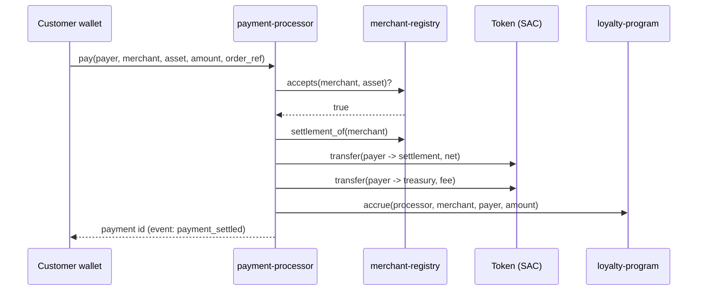

# StellarPOS Contracts

Soroban smart contracts for StellarPOS, a point-of-sale system for merchants
who accept payment on the Stellar network.

[](https://github.com/StellarPOS-App/contracts/actions/workflows/ci.yml)


This repository is one of three:

| Repository | What it is |
|---|---|
| [`contracts`](https://github.com/StellarPOS-App/contracts) (this repo) | On-chain settlement, loyalty, treasury and escrow |
| [`backend`](https://github.com/StellarPOS-App/backend) | REST + WebSocket API: catalog, sales, checkout, payment matching |
| [`surface`](https://github.com/StellarPOS-App/surface) | The point-of-sale web app cashiers and managers use |

## The contracts

| Crate | Purpose | Key entry points |
|---|---|---|
| [`merchant-registry`](contracts/merchant-registry/src/lib.rs) | Who may get paid, where funds settle, which assets each merchant takes | `register`, `approve`, `suspend`, `accepts`, `settlement_of` |
| [`payment-processor`](contracts/payment-processor/src/lib.rs) | Atomic sale settlement: fee to treasury, net to merchant, one payment per order | `pay`, `pay_batch`, `refund`, `payment_for_order`, `quote` |
| [`loyalty-program`](contracts/loyalty-program/src/lib.rs) | Per-merchant points with automatic Bronze/Silver/Gold/Platinum tiers | `enroll`, `accrue`, `redeem`, `get_account` |
| [`treasury`](contracts/treasury/src/lib.rs) | M-of-N multisig that holds protocol fees and can put idle funds into approved yield vaults | `propose`, `approve`, `execute`, `freeze`, `vaults` |
| [`escrow-service`](contracts/escrow-service/src/lib.rs) | Held payments for deliveries and pre-orders, with dispute resolution | `create`, `release`, `claim`, `raise_dispute`, `resolve`, `resolve_by_default` |
| [`payment-stream`](contracts/payment-stream/src/lib.rs) | Per-second payment streams for subscriptions, rent and payroll; cancel splits earned and unearned exactly | `create`, `withdraw`, `cancel`, `available` |
| [`shared`](contracts/shared/src/lib.rs) | Library, not deployed: basis-point fee math and storage TTL helpers | `bps_of`, `split_fee`, `extend_*` |

### How a sale settles



All transfers happen inside one transaction, so either the whole sale settles
or nothing moves. The processor never holds customer funds, and the
`(merchant, order_ref)` pair is unique, so a retried checkout cannot charge
twice.

### Design rules

These hold across every contract:

- **Typed errors, no panics on user input.** Each contract has a
  `#[contracterror]` enum. Clients get a stable numeric code for every
  rejection.
- **Events for every state change**, defined with `#[contractevent]`, so the
  backend and indexers can follow everything without polling storage.
- **Emergency pause.** Registry, processor, loyalty and escrow can be paused
  by their admin. Escrow refunds still work while paused, because returning
  funds to a buyer is always safe. The treasury uses a multisig freeze
  instead.
- **Checked arithmetic.** Fee and split math goes through `shared::bps_of`,
  which returns `None` on overflow or on more than 100%.
- **TTL management.** Every read or write of a long-lived record extends its
  TTL, so active data is never archived.

More detail on each contract, including state machines and storage layout, is
in [docs/architecture.md](docs/architecture.md).

## Getting started

### Prerequisites

- Rust stable with the `wasm32v1-none` target (pinned in
  [`rust-toolchain.toml`](rust-toolchain.toml), installed automatically by
  rustup)
- [Stellar CLI](https://developers.stellar.org/docs/tools/cli) 23 or newer,
  for building optimized wasm and deploying

### Build and test

```bash
git clone https://github.com/StellarPOS-App/contracts.git
cd contracts

make test      # 63 tests across all crates
make check     # rustfmt + clippy -D warnings + tests (what CI runs)
make build     # optimized wasm in target/wasm32v1-none/release/
make sizes     # wasm sizes, all well under the 64 KB limit
make verify    # check a deployment runs exactly this source (NETWORK=testnet)
```

### Deploy to testnet

```bash
make deploy                      # NETWORK=testnet, FEE_BPS=100 by default
NETWORK=testnet FEE_BPS=250 make deploy
```

[`scripts/deploy.sh`](scripts/deploy.sh) creates and funds a deployer
identity if needed, deploys all five contracts, initializes them, connects
the loyalty program to the processor, and writes every contract ID to
`deployments/<network>.json`. See [docs/deployment.md](docs/deployment.md)
for the post-deploy checklist (multisig rotation, merchant onboarding) and
example `stellar contract invoke` calls.

## Project layout

```
contracts/
  shared/               fee math and TTL helpers (rlib)
  merchant-registry/
  payment-processor/
  loyalty-program/
  treasury/
  escrow-service/
    src/dispute.rs      dispute reasons, role rules, default rulings
    tests/              end-to-end dispute scenarios
docs/                   architecture and deployment guides
scripts/deploy.sh       deploy + initialize + wire
deployments/            contract IDs per network (written by deploy.sh)
```

## Contributing

Read [CONTRIBUTING.md](CONTRIBUTING.md). In short: open an issue first for
anything non-trivial, keep pull requests focused, and run `make check`
before pushing. Security issues go through [SECURITY.md](SECURITY.md), never
public issues.

## License

[MIT](LICENSE)

## Slippage Protection\n\n**Security fix (issue #172):** Cross-currency conversions must accept a min_amount_out parameter. Without it, a price oracle update between quote and settlement can result in the customer receiving fewer tokens than expected with no recourse.